## 代码重构

为了方便后续的代码编写与维护，我们采用面向对象的思想，将不同的图形抽象成类，而所有的图形共有一父类——`Figure`。这个父类规定了子类，即不同图形，需完成的接口（这里就是符号距离函数），也储存子类所共有的属性，如颜色、模糊、透明度等。而各个特定图形子类拥有各自的属性来决定其形状，并完成父类遗留的符号距离函数接口。

下面是上述结构的UML图  

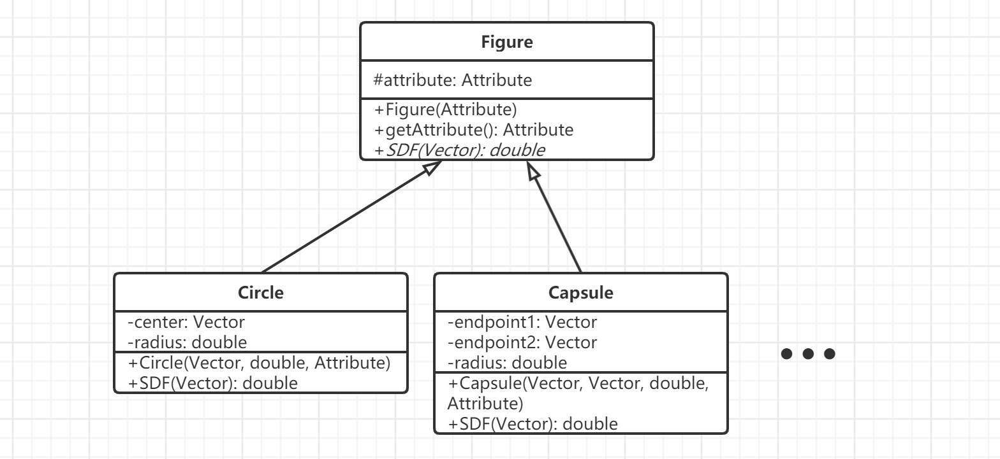

按照上述结构，我们可以重构一下上一篇博文中圆与胶囊的SDF函数：

```cpp
//父类：所有图形
class Figure
{
    public:
        //图形的共有属性
        typedef struct Attribute
        {
            Color color;
        }Attribute;

    protected:
        Attribute attribute;

    public:
        //构造函数，注意各个子类图形在构造时需调用父类的构造函数
        Figure(Attribute attribute)
        {
            this->attribute = attribute;
        }

        Attribute getAttribute()
        {
            return attribute;
        }

        //SDF接口
        virtual double SDF(Vector pos) = 0;
};

//圆，继承图形
class Circle : public Figure
{
    private:
        Vector center;      //圆心
        double radius;       //半径

    public:
        //构造函数，注意需调用父类构造函数
        Circle(Vector center, double radius, Attribute attribute) : Figure(attribute)
        {
            this->center = center;
            this->radius = radius;
        }

        //实现计算SDF的接口
        double SDF(Vector pos)
        {
            return (pos - center).module() - radius;
        }
};

//胶囊，继承图形
class Capsule : public Figure
{
    private:
        Vector endpoint1;       //端点1
        Vector endpoint2;       //端点2
        double radius;           //半径

    public:
        Capsule(Vector endpoint1, Vector endpoint2, double radius, Attribute attribute) : Figure(attribute)
        {
            this->endpoint1 = endpoint1;
            this->endpoint2 = endpoint2;
            this->radius = radius;
        }

        double SDF(Vector pos)
        {
            Vector V1 = endpoint2 - endpoint1;
            Vector V2 = pos - endpoint1;
            if (V1 * V2 <= 0)
                return V2.module() - radius;
            else
            {
                Vector V3 = pos - endpoint2;
                if (V1 * V3 >= 0)
                    return V3.module() - radius;
                else
                    return fabs(V1.normalVector() * V2) - radius;
            }
        }
};
````

这样让所有图形继承一个父类的好处就是，绘图函数不需要针对特定的图形，而只需根据父类 `Figure` 及其方法即可。

绘图函数可以这样写：(伪代码)

```cpp
void draw(Figure figure)
{
    for (int i = 0; i < width; i++)
        for (int j = 0; j < height; j++)
            if (figure.SDF() < 0) setPixel();
}
```

## 基本图形

下面我们将列举一些常用的基本图形的符号距离函数。（注：下面类的实现中均省略构造函数）

> 基本图形SDF的部分算法与图片来源于 [Inigo Quilez :: fractals, computer graphics, mathematics, shaders, demoscene and more](http://iquilezles.org/www/articles/distfunctions2d/distfunctions2d.htm)，作者在学习时也是参考的这个网站所列举的实现。

### 圆

推导见上一篇中 [圆的有符号距离场](/zh/blogs/draw-with-cpp-2#圆的有符号距离场)。

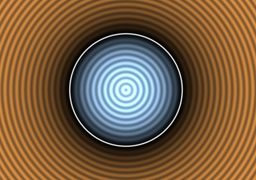

```cpp
class Circle : public Figure
{
    private:
        Vector center;      //圆心
        double radius;       //半径

    public:
        //实现计算SDF的接口
        double SDF(Vector pos)
        {
            return (pos - center).module() - radius;
        }
};
```

### 线段（胶囊）

推导见上一篇中 [直线（胶囊）的有符号距离场](/zh/blogs/draw-with-cpp-2#直线（胶囊）的有符号距离场)。

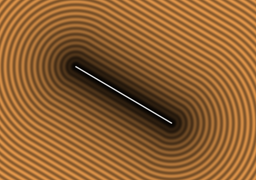

```cpp
class Capsule : public Figure
{
    private:
        Vector endpoint1;       //端点1
        Vector endpoint2;       //端点2
        double radius;           //半径

    public:
        double SDF(Vector pos)
        {
            Vector V1 = endpoint2 - endpoint1;
            Vector V2 = pos - endpoint1;
            if (V1 * V2 <= 0)
                return V2.module() - radius;
            else
            {
                Vector V3 = pos - endpoint2;
                if (V1 * V3 >= 0)
                    return V3.module() - radius;
                else
                    return fabs(V1.normalVector() * V2) - radius;
            }
        }
};
```

### 变宽胶囊

变宽胶囊指两端半径不同，宽度沿线段均匀变化的胶囊的变种，如图：

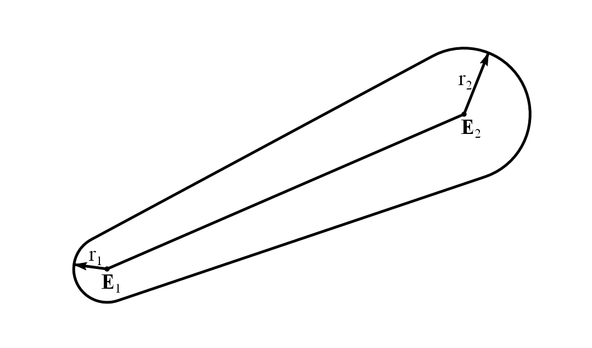

可知变宽胶囊有6个自由度：两个端点占4个、两端的半径占2个。此图形可以使用四个量确定：端点 $\boldsymbol E_1,\boldsymbol E_2$、半径 $r_1,r_2$。

为了便于计算，我们将图形旋转平移，使得 $\boldsymbol E_1$ 位于原点，$\boldsymbol E_2$ 位于 $x$ 轴正半轴，对应的平移矢量为 $-\boldsymbol E_1$，旋转角度为 $\alpha=-\mathrm{atan2}(\boldsymbol E_{2y}-\boldsymbol E_{1y},\boldsymbol E_{2x}-\boldsymbol E_{1x})$，如图

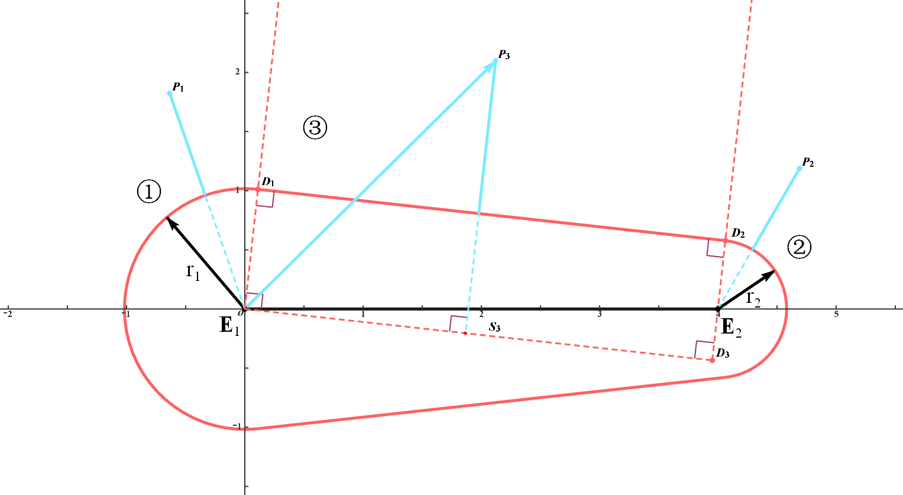

令 $d_x=\boldsymbol E_{2x}-\boldsymbol E_{1x},d_y=\boldsymbol E_{2y}-\boldsymbol E_{1y}$，则

$$
\cos\alpha=\frac{d_x}{\sqrt{d_x^2+d_y^2}},\sin\alpha=-\frac{d_y}{\sqrt{d_x^2+d_y^2}}
$$

与此同时，目标点 $\boldsymbol P$ 的坐标变换为

$$
\boldsymbol P'=\left(\begin{matrix}
	\cos\alpha&-\sin\alpha\\
	\sin\alpha&\cos\alpha\\
\end{matrix}\right)(\boldsymbol P-\boldsymbol E_1)
=\frac1{\sqrt{d_x^2+d_y^2}}\left(\begin{matrix}
	d_x&d_y\\
	-d_y&d_x\\
\end{matrix}\right)(\boldsymbol P-\boldsymbol E_1)
$$

从图中容易看出该图形按 $x$ 轴轴对称，于是我们只考虑上半平面的部分，由对称即可得到下半平面。

图中 $E_1D_3$ 平行于图形的上边界 $D_1D_2$，且位于被考察区域外，故可用于区域③中距离的计算。这是 $r_1>r_2$ 的情况下，若 $r_2>r_1$，$E_1D_3$ 就不再位于考察区域外了，故在初始化时建议先将两个端点按半径排好序。

图中

$$
\begin{gather}
E_1E_2=\|\boldsymbol E_2-\boldsymbol E_1\|\\
E_2D_3=D_2D_3-E_2D_2=E_1D_1-E_2D_2=r_1-r_2\\
\end{gather}
$$

故

$$
\begin{gather}
\sin\angle E_2E_1D_3=\frac{E_2D_3}{E_1E_2}=\frac{r_1-r_2}{\|\boldsymbol E_2-\boldsymbol E_1\|}\\
\cos\angle E_2E_1D_3=\sqrt{1-\sin^2\angle E_2E_1D_3}
\end{gather}
$$

令 $a=\sin\angle E_2E_1D_3=\frac{r_1-r_2}{\|\boldsymbol E_2-\boldsymbol E_1\|}$, $b=\cos\angle E_2E_1D_3=\sqrt{1-a^2}$，可以得到

$E_1D_3$ 的长度为 $b\|\boldsymbol E_2-\boldsymbol E_1\|$ 方向的单位向量为 $\boldsymbol L=(b,-a)$，其逆时针转90°的单位法向量为 $\boldsymbol N=(a,b)$，类似胶囊SDF函数有

$$
f_{uneven\ capsule}(\boldsymbol P)=\left\{\begin{split}
	&\|\boldsymbol P'-\boldsymbol E_1\|-r_1&(\boldsymbol P'-\boldsymbol E_1)\cdot\boldsymbol L\le0\\
	&\|\boldsymbol P'-\boldsymbol E_2\|-r_2&(\boldsymbol P'-\boldsymbol E_1)\cdot\boldsymbol L\ge b\|\boldsymbol E_2-\boldsymbol E_1\|\\
	&(\boldsymbol P'-\boldsymbol E_1)\cdot\boldsymbol N-r_1\quad\quad&0<(\boldsymbol P'-\boldsymbol E_1)\cdot\boldsymbol L<b\|\boldsymbol E_2-\boldsymbol E_1\|
\end{split}\right.
$$

算法为：

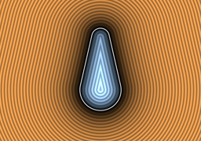

```cpp
class UnevenCapsule : public Figure
{
    private:
        Vector endpoint1;
        Vector endpoint2;
        double radius1;
        double radius2;

    public:
        double SDF(Vector pos)
        {
            double dx = endpoint2.x - endpoint1.x;
            double dy = endpoint2.y - endpoint1.y;
            double h = sqrt(dx * dx + dy * dy);
            double cos_ = dx / h;
            double sin_ = -dy / h;
            Vector E1 = {0, 0};
            Vector E2 = {h, 0};
            double a = (radius1 - radius2) / h;
            double b = sqrt(1 - a * a);
            Vector L = {b, -a};
            Vector N = {a, b};
            pos = pos - endpoint1;
            Vector pos_ = {cos_ * pos.x - sin_ * pos.y, fabs(sin_ * pos.x + cos_ * pos.y)};
            double jdg = (pos_ - E1) * L;
            if (jdg <= 0)
                return (pos_ - E1).module() - radius1;
            else if (jdg >= b * h)
                return (pos_ - E2).module() - radius2;
            else
                return (pos_ - E1) * N - radius1;
        }
};
```

### 矩形

矩形有五个自由度：长、宽、中心x、中心y、旋转角度。在这里我们使用三个量表示：中心 $\boldsymbol C$、尺寸 $\boldsymbol S$、旋转角 $\theta$

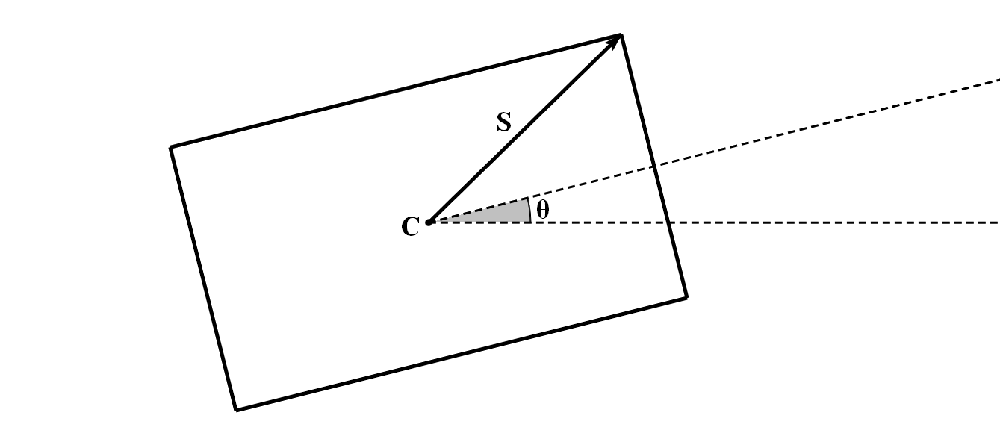

其中中心 $\boldsymbol C$、旋转角 $\theta$ 可以靠坐标的平移和旋转变换使之为 $0$，与此同时，目标点 $\boldsymbol P$ 的坐标变换为

$$
\boldsymbol P'=\left(\begin{matrix}
	\cos\theta&\sin\theta\\
	-\sin\theta&\cos\theta\\
\end{matrix}\right)(\boldsymbol P-\boldsymbol C)
$$

考虑到矩形拥有四等分对称性，我们只考虑第一象限的部分，由对称即可得到其余部分，如图

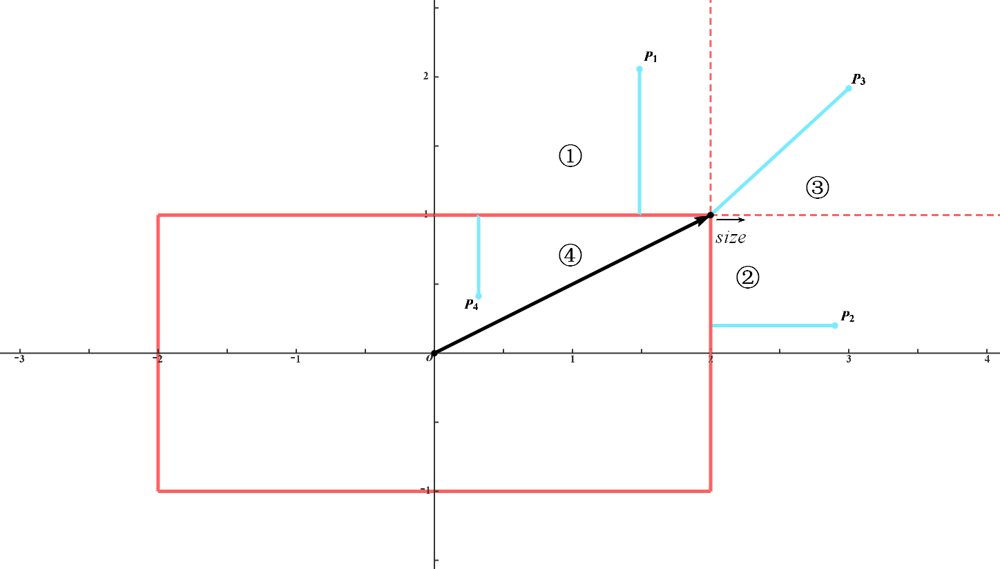

在图中标识出了四个区域，在每个区域中距离的计算方法是不同的，易知

$$
f_{Rectangle}(\boldsymbol P)=\left\{\begin{split}
	&\boldsymbol P'_y-\boldsymbol S_y&\boldsymbol P'\in①\\
	&\boldsymbol P'_x-\boldsymbol S_x&\boldsymbol P'\in②\\
	&\|\boldsymbol P'-\boldsymbol S\|&\boldsymbol P'\in③\\
	&\mathrm{max}\{\boldsymbol P'_x-\boldsymbol S_x,\boldsymbol P'_y-\boldsymbol S_y\}\quad\quad&\boldsymbol P'\in④
\end{split}\right.
$$

在考虑上各区域的条件

$$
f_{Rectangle}(\boldsymbol P)=\left\{\begin{split}
	&\boldsymbol P'_y-\boldsymbol S_y&\boldsymbol P'_x<\boldsymbol S_x,\boldsymbol P'_y>\boldsymbol S_y\\
	&\boldsymbol P'_x-\boldsymbol S_x&\boldsymbol P'_x>\boldsymbol S_x,\boldsymbol P'_y<\boldsymbol S_y\\
	&\|\boldsymbol P'-\boldsymbol S\|&\boldsymbol P'_x>\boldsymbol S_x,\boldsymbol P'_y>\boldsymbol S_y\\
	&\mathrm{max}\{\boldsymbol P'_x-\boldsymbol S_x,\boldsymbol P'_y-\boldsymbol S_y\}\quad\quad&\boldsymbol P'_x<\boldsymbol S_x,\boldsymbol P'_y<\boldsymbol S_y
\end{split}\right.
$$

算法为：


```cpp
class Rectangle : public Figure
{
    private:
        Vector center;
        Vector size;
        double theta;

    public:
        double SDF(Vector pos)
        {
            double cos_ = cos(theta);
            double sin_ = sin(theta);
            pos = pos - center;
            Vector pos_ = {fabs(cos_ * pos.x + sin_ * pos.y), fabs(-sin_ * pos.x + cos_ * pos.y)};
            if (pos_.x > size.x)
            {
                if (pos_.y > size.y)
                    return (pos_ - size).module();
                else
                    return pos_.x - size.x;
            }
            else
            {
                if (pos_.y > size.y)
                    return pos_.y - size.y;
                else
                    return max(pos_.y - size.y, pos_.x - size.x);
            }
        }
};
```

<h5 id="三角形">三角形</h5>

三角形显然是由三个顶点 $\boldsymbol V_1,\boldsymbol V_2,\boldsymbol V_3$ 所决定的，如图

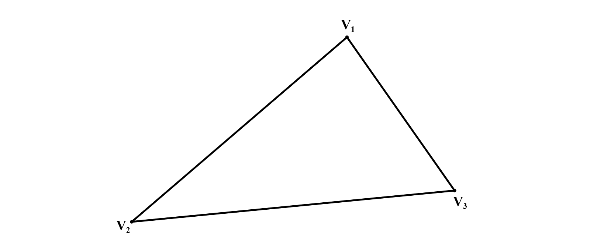

为计算三角形的SDF，可以将三条边单独考虑，求出目标点到三条边的距离的最小值，即为SDF的绝对值。求一点到线段的距离在胶囊图形已经讲过。

剩下的问题在于：如何判断目标点是不是在三角形内部？

一个可行的方法是利用凸多边形与叉乘的性质。

沿一个方向遍历凸多边形的所有边，则对于位于凸多边形内部的点，它总在被考察有向边的同一侧。而三角形必然是一个凸多边形。

例如上图中，三角形内部的点位于 $V_1V_2,V_2V_3,V_3V_1$ 的左侧。

根据右手定则，若点 $P$ 在有向线段 $V_iV_j$ 左侧，则

$$
[(\boldsymbol V_j-\boldsymbol V_i)\times(\boldsymbol P-\boldsymbol V_i)].z>0
$$

反之

$$
[(\boldsymbol V_j-\boldsymbol V_i)\times(\boldsymbol P-\boldsymbol V_i)].z<0
$$

综上，在三角形中，令

$$
\begin{gather}
	\boldsymbol L_1=\boldsymbol V_2-\boldsymbol V_1,\quad\boldsymbol L_2=\boldsymbol V_3-\boldsymbol V_2,\quad\boldsymbol L_3=\boldsymbol V_1-\boldsymbol V_3\\
	\boldsymbol P_1=\boldsymbol P-\boldsymbol V_1,\quad\boldsymbol P_2=\boldsymbol P-\boldsymbol V_2,\quad\boldsymbol P_3=\boldsymbol P-\boldsymbol V_3
\end{gather}
$$

若点 $P$ 在三角形内部，则

$$
\boldsymbol L_{1x}\boldsymbol P_{1y}-\boldsymbol L_{1y}\boldsymbol P_{1x},\quad\boldsymbol L_{2x}\boldsymbol P_{2y}-\boldsymbol L_{2y}\boldsymbol P_{2x},\quad\boldsymbol L_{3x}\boldsymbol P_{3y}-\boldsymbol L_{3y}\boldsymbol P_{3x}
$$

三者同号。算法为：

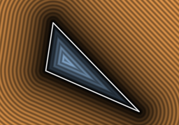

```cpp
class Triangle : public Figure
{
    private:
        Vector vertex1;
        Vector vertex2;
        Vector vertex3;

    public:
        double SDF(Vector pos)
        {
            double d1 = segmentSDF(vertex1, vertex2, pos);
            double d2 = segmentSDF(vertex2, vertex3, pos);
            double d3 = segmentSDF(vertex3, vertex1, pos);
            double d = min(min(d1, d2), d3);
            if ((((vertex2.x - vertex1.x) * (pos.y - vertex1.y) - (vertex2.y - vertex1.y) * (pos.x - vertex1.x) > 0) &&
                ((vertex3.x - vertex2.x) * (pos.y - vertex2.y) - (vertex3.y - vertex2.y) * (pos.x - vertex2.x) > 0) &&
                ((vertex1.x - vertex3.x) * (pos.y - vertex3.y) - (vertex1.y - vertex3.y) * (pos.x - vertex3.x) > 0)) ||
                (((vertex2.x - vertex1.x) * (pos.y - vertex1.y) - (vertex2.y - vertex1.y) * (pos.x - vertex1.x) < 0) &&
                ((vertex3.x - vertex2.x) * (pos.y - vertex2.y) - (vertex3.y - vertex2.y) * (pos.x - vertex2.x) < 0) &&
                ((vertex1.x - vertex3.x) * (pos.y - vertex3.y) - (vertex1.y - vertex3.y) * (pos.x - vertex3.x) < 0)))
                return -d;
            else
                return d;
        }
};
```

### 多边形

在上篇博文中我们提到过使用扫描线算法绘制多边形，那么我们来看看怎样构建多边形的SDF。

多边形由 $n$ 个顶点 $V_1,V_2,\cdots,V_n$ 所描述，其中 $n\ge3$。

有了三角形SDF的经验，我们知道，多边形的SDF的绝对值即为目标点到多边形所有边的距离的最小值。问题来到了怎样判断一个点是不是在多边形内。在扫描线算法中，两两一对的交点所构造的线段位于图形的内部。这说明若一个点位于图形的内部，则在与它同高的扫描线与图形的交点中有奇数个位于此点的同一侧。如图

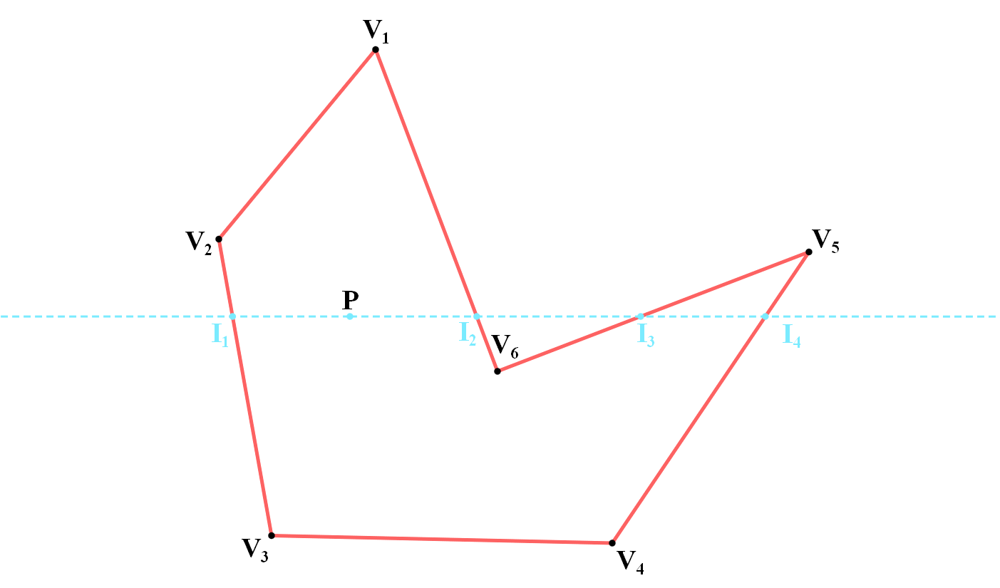

可见图中 $P$ 点左侧有1个交点，右侧有3个交点，都为奇数。由此我们的目的很明确了：计算出位于目标点左侧的交点的个数，以此来判断目标点是否在多边形内部。

这个问题可以分解为两个子问题：

- 判断一条边是否与目标点高度的扫描线有交点
- 判断交点在目标点的哪一侧

第一个问题容易解决，判断 $P$ 的纵坐标是否在这条边的两个端点的纵坐标之间即可。

第二个问题我们需要反过来考虑，可以判断目标点在交点的哪一侧，即目标点在这条边的哪一侧。在三角形SDF的推导中，我们提到利用向量叉乘判断点在有向边的哪一侧，我们沿用这个方法。但是注意，在有向边向上的时候，它的左侧才与屏幕的左侧一致，若有向边向下，它的右侧才是屏幕的左侧。

写成公式即为

$$
\begin{gather}
\boldsymbol E_1=\boldsymbol V_2-\boldsymbol V_1,\quad\boldsymbol E_2=\boldsymbol V_3-\boldsymbol V_2,\cdots,\boldsymbol E_n=\boldsymbol V_1-\boldsymbol V_n\\
\boldsymbol W_1=\boldsymbol P-\boldsymbol V_1,\quad\boldsymbol W_2=\boldsymbol P-\boldsymbol V_2,\cdots,\boldsymbol W_n=\boldsymbol P-\boldsymbol V_n\\
f_{polygon}(\boldsymbol P)=(-1)^j\min\{d(P,V_1V_2),d(P,V_2V_3),\cdots,d(P,V_nV_1)\}\\
j=\sum_{i=1}^n((\boldsymbol E_i\times\boldsymbol W_i).z>0\land \boldsymbol E_{iy}>\boldsymbol W_{iy}\land\boldsymbol W_{iy}>0)\lor((\boldsymbol E_i\times\boldsymbol W_i).z<0\land \boldsymbol E_{iy}<\boldsymbol W_{iy}\land\boldsymbol W_{iy}<0)
\end{gather}
$$

算法为

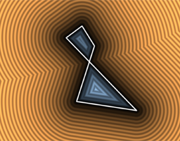

```cpp
class Polygon : public Figure
{
    private:
        Vector* vertex;
        int vertexNummber;

    public:
        double SDF(Vector pos)
        {
            Vector E, W;
            double d = 1e10;
            int s = 1;
            for (int i = 0, j; i < vertexNummber; i++)
            {
                j = (i + 1) % vertexNummber;
                d = min(d, segmentSDF(vertex[i], vertex[j], pos));
                if ((vertex[j].y >= pos.y && vertex[i].y < pos.y &&
                    (vertex[j].x - vertex[i].x) * (pos.y - vertex[i].y) -
                    (vertex[j].y - vertex[i].y) * (pos.x - vertex[i].x) > 0) ||
                    (vertex[i].y >= pos.y && vertex[j].y < pos.y &&
                    (vertex[j].x - vertex[i].x) * (pos.y - vertex[i].y) -
                    (vertex[j].y - vertex[i].y) * (pos.x - vertex[i].x) < 0))
                    s *= -1;
            }
            return s * d;
        }
};
```    

### 扇形

扇形也是常用的图形之一，它由4个量表征：圆心 $\boldsymbol C$，半径 $r$ 以及起始角度 $\theta_1,\theta_2$，如图

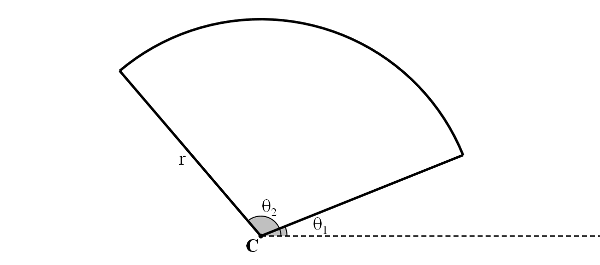

处理它的SDF仍需根据对称性将其平移旋转：圆心与坐标原点重合，角平分线与 $x$ 轴重合。则平移向量为 $-\boldsymbol C$，旋转角为 $-\frac{\theta_1+\theta_2}2$ 

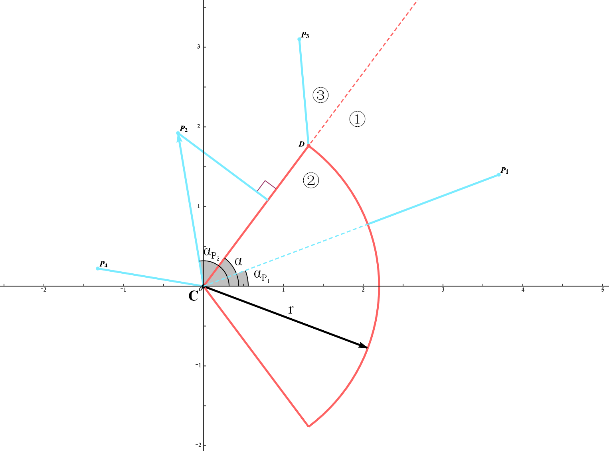

$\boldsymbol P'$ 的坐标与前文一样变换。由于扇形的轴对称性，我们只需考察上半平面即可。沿上半平面中的径向边与圆弧可将被考察区域分为三部分。

在①中，SDF即为到圆弧的距离，也就是到圆心的距离减去半径。

$$
f_{pie}=\|\boldsymbol P'\|-r\quad\quad\boldsymbol P'\in①
$$

在②中，SDF为到圆弧的距离与到径向边的距离中较小的那个的相反数。

$$
f_{pie}=\mathrm{max}\{\|\boldsymbol P'\|-r,-d(P',CD)\}\quad\quad\boldsymbol P'\in②
$$

在③中，SDF为到径向边的距离

$$
f_{pie}=d(P',CD)\quad\quad\boldsymbol P'\in③
$$

算法为：


```cpp
class Pie : public Figure
{
    private:
        Vector center;
        double radius;
        double theta1;
        double theta2;

    public:
        double SDF(Vector pos)
        {
            double cos_ = cos((theta1 + theta2) / 2);
            double sin_ = sin((theta1 + theta2) / 2);
            Vector O = {0, 0};
            Vector D = {radius * cos((theta2 - theta1) / 2), radius * sin((theta2 - theta1) / 2)};
            pos = pos - center;
            Vector pos_ = {cos_ * pos.x + sin_ * pos.y, fabs(-sin_ * pos.x + cos_ * pos.y)};
            double l = pos_.module();
            if (D.x * pos_.y - D.y * pos_.x > 0)
                return segmentSDF(O, D, pos_);
            else if (l >= radius)
                return l - radius;
            else
                return max(l - radius, -segmentSDF(O, D, pos_));
        }
};
```

### 弧

与扇形有关系的有另一个图形——圆弧，它由5个量表示：圆心 $\boldsymbol C$，弧半径 $r_1$，弧半宽 $r_2$ 以及起始角度 $\theta_1,\theta_2$，如图

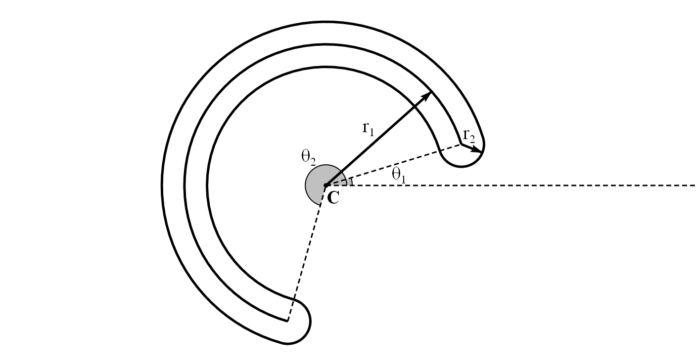

它的SDF与扇形类似，有一点小改动

在①或②中，SDF即为到圆弧的距离减去半宽

$$
f_{pie}=\|\|\boldsymbol P'\|-r_1\|-r_2\quad\quad\boldsymbol P'\in①\cup②
$$

在③中，SDF为到弧的端点的距离减去半宽

$$
f_{pie}=\|\boldsymbol P'-\boldsymbol D\|-r_2\quad\quad\boldsymbol P'\in③
$$

算法为：


```cpp
class Arc : public Figure
{
    private:
        Vector center;
        double radius1;
        double radius2;
        double theta1;
        double theta2;

    public:
        double SDF(Vector pos)
        {
            double cos_ = cos((theta1 + theta2) / 2);
            double sin_ = sin((theta1 + theta2) / 2);
            Vector O = {0, 0};
            Vector D = {radius1 * cos((theta2 - theta1) / 2), radius1 * sin((theta2 - theta1) / 2)};
            pos = pos - center;
            Vector pos_ = {cos_ * pos.x + sin_ * pos.y, fabs(-sin_ * pos.x + cos_ * pos.y)};
            double l = pos_.module();
            if (D.x * pos_.y - D.y * pos_.x > 0)
                return (pos_ - D).module() - radius2;
            else
                return fabs(l - radius1) - radius2;
        }
};
```
 
### 椭圆

为求椭圆SDF，关键在于找到椭圆上哪一点到目标点距离最短，这不是那么容易的。

考虑进行平移和旋转变换，我们只需考虑一个标准的中心在原点，焦点在 $x$ 轴上的椭圆，满足

$$
\frac{x^2}{a^2}+\frac{y^2}{b^2}=1
$$

由对称性，只需考虑第一象限。容易想到，当目标点到椭圆上一点的连线与椭圆过这点的切线垂直时，这点就是我们要找的最近点，可列方程

$$
\left\{\begin{split}
	&\frac{y_p-y}{x_p-x}\frac{b^2x}{a^2y}=1\\
	&y=\frac ba\sqrt{a^2-x^2}
\end{split}\right.
$$

最终会得到一个四次方程。。。

$$
\frac{(a^2-b^2)^2}{a^2}x^4-2(a^2-b^2)x_px^3+(b^2y_p^2+a^2x_p^2-(a^2-b^2)^2)x^2+2a^2(a^2-b^2)x_px-a^4x_p=0
$$

参考椭圆的参数方程，令 $x=a\cos\theta,u=\cos\theta$

$$
(a^2-b^2)^2u^4-2a(a^2-b^2)x_pu^3+(b^2y_p^2+a^2x_p^2-(a^2-b^2)^2)u^2+2a(a^2-b^2)x_pu-a^2x_p=0
$$

再令 $m=\frac{a}{a^2-b^2}x_p,n=\frac{b}{a^2-b^2}y_p$

$$
u^4-2mu^3+(m^2+n^2-1)u^2+2mu-m^2
$$

四次方程的求解非常复杂…（可以参考：[Quartic Equation -- from Wolfram MathWorld](https://mathworld.wolfram.com/QuarticEquation.html)，[distance to an ellipse - iquilezles](http://www.iquilezles.org/www/articles/ellipsedist/ellipsedist.htm)），最后我们直接给出算法：

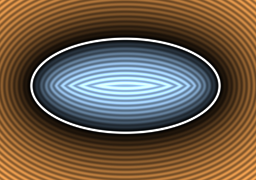

```cpp
class Ellipse : public Figure
{
    private:
        Vector center;
        double a;
        double b;
        double theta;

    public:
        double SDF(Vector pos)
        {
            double cos_ = cos(theta);
            double sin_ = sin(theta);
            pos = pos - center;
            Vector p = {fabs(cos_ * pos.x + sin_ * pos.y), fabs(-sin_ * pos.x + cos_ * pos.y)};
            double a = this->a, b = this->b;
            if(p.x > p.y)
            {
                swap(p.x, p.y);
                swap(a, b);
            }
            double l = b * b - a * a;
            double m = a * p.x / l;
            double m2 = m * m; 
            double n = b * p.y / l;
            double n2 = n * n; 
            double c = (m2 + n2 - 1.0) / 3.0;
            double c3 = c * c * c;
            double q = c3 + m2 * n2 * 2.0;
            double d = c3 + m2 * n2;
            double g = m + m * n2;
            double co;
            if( d < 0.0 )
            {
                double h = acos(q / c3) / 3.0;
                double s = cos(h);
                double t = sin(h) * sqrt(3.0);
                double rx = sqrt(-c * (s + t + 2.0) + m2);
                double ry = sqrt(-c * (s - t + 2.0) + m2);
                co = (ry + (l > 0 ? 1 : -1) * rx + fabs(g) / (rx * ry) - m) / 2.0;
            }
            else
            {
                double h = 2.0 * m * n * sqrt(d);
                double s = (q + h > 0 ? 1 : -1) * pow(fabs(q + h), 1.0 / 3.0);
                double u = (q - h > 0 ? 1 : -1) * pow(fabs(q - h), 1.0 / 3.0);
                double rx = -s - u - c * 4.0 + 2.0 * m2;
                double ry = (s - u) * sqrt(3.0);
                double rm = sqrt(rx * rx + ry * ry);
                co = (ry / sqrt(rm - rx) + 2.0 * g / rm - m) / 2.0;
            }
            Vector r = {a * co, b * sqrt(1 - co * co)};
            return (r - p).module() * (p.y - r.y > 0 ? 1 : -1);
        }
};
```

### 二阶贝塞尔曲线

定义与推导参考 [二阶贝塞尔曲线与 cc.Bezier - 简书](https://www.jianshu.com/p/3740a348d524)  

求其SDF与求椭圆SDF类似考虑，求出切线垂直点，最后是一个三次方程，解它也比较困难，参考 [Cubic Equation -- from Wolfram MathWorld](https://mathworld.wolfram.com/CubicEquation.html)  

直接给出算法：

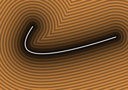

```cpp
class QuadraticBezier : public Figure
{
    private:
        Vector A;
        Vector B;
        Vector C;

    public:
        double SDF(Vector pos)
        {
            Vector a = B - A;
            Vector b = A - B * 2.0 + C;
            Vector c = a * 2.0;
            Vector d = A - pos;
            double kk = 1.0 / (b * b);
            double kx = kk * (a * b);
            double ky = kk * (2.0 * (a * a) + (d * b)) / 3.0;
            double kz = kk * (d * a);      
            double p = ky - kx * kx;
            double p3 = p * p * p;
            double q = kx * (2.0 * kx * kx - 3.0 * ky) + kz;
            double h = q * q + 4.0 * p3;
            double res = 0.0;
            if(h >= 0) 
            { 
                h = sqrt(h);
                double x = (h - q) / 2.0;
                double y = (-h - q) / 2.0;
                double u = (x > 0 ? 1 : -1) * pow(fabs(x), 1.0 / 3.0);
                double v = (y > 0 ? 1 : -1) * pow(fabs(y), 1.0 / 3.0);
                double t = u + v - kx;
                t = (t < 0 ? 0 : (t > 1 ? 1 : t));
                Vector e = d + (c + b * t) * t;
                res = e * e;
            }
            else
            {
                double z = sqrt(-p);
                double v = acos(q / (p * z * 2.0)) / 3.0;
                double m = cos(v);
                double n = sin(v) * sqrt(3);
                double x = (m + m) * z - kx;
                x = (x < 0 ? 0 : (x > 1 ? 1 : x));
                double y = (-n - m) * z - kx;
                y = (y < 0 ? 0 : (y > 1 ? 1 : y));
                Vector e = d + (c + b * x) * x;
                Vector f = d + (c + b * y) * y;
                res = min(e * e, f * f);
            }
            return sqrt(res);
        }        
};
````

### 更多

更多其他图形请前往 [Inigo Quilez :: fractals, computer graphics, mathematics, shaders, demoscene and more](http://iquilezles.org/www/articles/distfunctions2d/distfunctions2d.htm) 探索。

## 基本操作

基本操作即可以对所有图形所作的操作，即为可以在父类 `Figure` 中完成的操作，本文中介绍两种：圆化，环化。

### 圆化

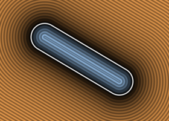
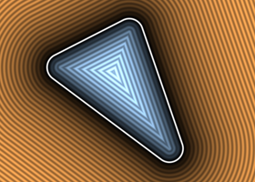

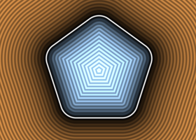

圆化意为将图形中原来的转角变成圆弧，例如将矩形变成圆角矩形。实现也非常简单，将SDF减去圆化半径即可。

为实现此操作，在 `Figure::Attribute` 中加入属性 `double roundedRadius;`，变换函数：

```cpp
double rSDF(Vector pos)
{
    return SDF(pos) - attribute.roundedRadius;
}
```

### 环化

环化意为以原来图形的边界形成环，例如将矩形变成矩形框。实现为：取SDF的绝对值减去环化半径。

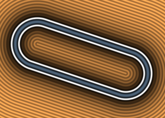
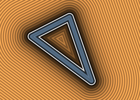


为实现此操作，在 `Figure::Attribute` 中加入属性 `double annularRadius;`，变换函数：

```cpp
double aSDF(Vector pos)
{
    return fabs(SDF(pos)) - attribute.annularRadius;
}
```

## 代码

本节代码请查看：[🔗Github: JeffreyXiang/DrawWithCpp](https://github.com/JeffreyXiang/DrawWithCpp/tree/master/src/3_figures)

## 总结

本章我们给出了许多基本图形的SDF，并介绍了两个基本操作来拓展他们的应用，后续这些基本图形元素将组成我们的图片。求解过程中，我们运用（复习）了一些解析几何与向量的知识，并了解了一些高次方程的解法（虽然我还是不会）。

## 预告

下一章我将介绍如何使用今天所编写的基本图形合成更复杂的图形——构造实体几何(CSG)。

